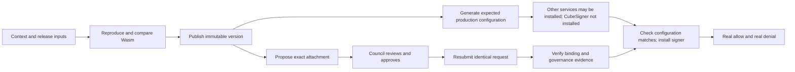

# CubeSigner preparation workflow: audit and requirements

Status: implementation handoff; operator workflow agreed, implementation pending.
Reviewed: 2026-10-19.

Scope update (2026-10-20): compatibility with older preparation-plan layouts is
not required. Resume applies to the current workflow only; historical migration
behavior recorded in the audit below is not an implementation requirement.

## Decision

**Prepare configuration before Council approval; do not install the CubeSigner
signer until attachment has executed and activation checks pass.** This is the
agreed first implementation. Do not implement a running signer that repeatedly
fails signing until governance changes, or an automatic activation controller.

The CLI supports important parts of the rehearsed CubeSigner workflow. Preserve
them, but move the attachment/governance gate out of configuration generation and
into explicit signer installation/activation verification. Preparing materials,
checking governance, publishing artifacts and delivering the signer kit need
clear boundaries; a compatibility orchestration command may remain.

Operators must be able to finish the documented procedure without reconstructing
commands, receipt schemas, or approval semantics from chat or an AI assistant.
The CLI need not implement Council voting: it should integrate the reviewed Core
governance tooling and expose durable handoffs and accurate verification states.

This is a source audit, not a new live provider audit or production certification.
It authorizes no policy mutation, approval, session rotation, or deployment.
This document supersedes its earlier suggestion that policy verification must
precede all rendering. The implementation agent should change the CLI and tests,
not operate the rehearsal's cloud resources or install its Helm releases.

## Audited revisions and authoritative references

- CLI: `e6c9c8f1f783125e649a911d3dbee2578c2ef490`, local branch
  `fix/mainnet-retrospective-20261017`. Existing unrelated changes in
  `values-generator.ts` and its generator test were left untouched.
- Core checkout: `73b06275a0ef19b4a761319215522f6671d2a408`,
  `v0.3.0-develop`.
- The governance runbook and tool README used in the rehearsal are **absent from
  that Core checkout**. They were read from available commit
  `7bf8fcefb34bfeb1fd835193b1b8500cd0f48549`, not assumed to be merged:
  [TEE key operations](https://github.com/DogeOS69/dogeos-core/blob/7bf8fcefb34bfeb1fd835193b1b8500cd0f48549/docs/runbooks/cubesigner-tee-key-operations.md),
  [governance tool](https://github.com/DogeOS69/dogeos-core/blob/7bf8fcefb34bfeb1fd835193b1b8500cd0f48549/tools/cubesigner/governance/README.md).
  The runbook says **draft**, with production use conditional on open decisions
  and disposable-organization acceptance tests. Treat its operation boundaries
  as the reference for this proposal, not proof those conditions have passed.
- Existing CLI operator procedure:
  [external policy runbook](cubesigner-external-policy.md).
- Core's older `tools/cubesigner/policy-push.sh` is not a substitute for the
  governed workflow; the pinned runbook explicitly warns against using it on
  the production key because it replaces the policy list.

Core documentation contains an ambiguous introductory sentence suggesting that
approval makes a change effective. Its detailed approved-change step 5 and the
governance tool README explicitly require resubmission. The CLI must follow and
document the explicit sequence: **approve, execute the identical request, then
verify**. Do not propagate that introductory ambiguity.

The current Core verifier README's "Tests and production boundary" section
requires evidence before **production activation**, not before generating YAML.
The pinned runbook's verifier-upgrade sequence is attachment, verification, then
updating/rolling the signer. Core's signer documentation describes a static
readiness gate, not polling for Council approval or remote attachment convergence.
Separating early configuration from later installation is this CLI design's
implementation of those boundaries, not a claim that Core mandates our CLI stages.

## What the rehearsal actually required

The following sequence is reconstructed from the deployment conversation. It
describes observed operator work, not a claim of fresh provider verification.
Deployment IDs, tokens, and private receipt contents are intentionally omitted.

1. Obtain the prepared TEE key/role from the owner; use the correct public key in
   the genesis Bridge script. Preserve genesis and protocol-context bytes.
2. Export `protocol_context.json`, the WP proof artifact base URL and public
   Bridge script for the release owner. An early standalone protocol-context
   stage was needed to avoid waiting on policy preparation first.
3. Build with the release owner's pinned `build-verifier.sh` procedure on Linux.
   The policy source commit and script commit were separate pins. Compare the
   resulting Wasm SHA-256 with the independent builder. A generic compiler image
   was not interchangeable for this rehearsal.
4. Publish the reviewed Wasm as a concrete named-policy version. Publication did
   not change the version attached to the key.
5. Propose replacing the attached version while retaining `RequireRoleSession`.
   The proposal returned an MFA pending-operation ID; it was not completed yet.
6. Council members reviewed and approved the exact request. The rehearsal used
   two approvals; that count is not a universal production default.
7. Resubmit the identical attachment with the approval ID, then read back the key
   and immutable policy version and compare the hash and binding.
8. Preserve Wasm, context, Bridge public artifact and provider evidence privately.
   Owner-only key attestation failed for the operator; Full role attestation was
   available. Capturing a JWT is distinct from verifying its signature/claims.
9. Import the external build and reconcile release/attachment references into the
   CLI. The operation record, release receipt and attachment receipt were
   different schemas, not differently named policies.
10. Bake/check proof materials, publish the proof bundle, export/publish the
    signer kit, render, create/upload runtime session Secrets and install services.
    Session preparation was initially manual; current source now includes it.
11. Verify WP proof references and gateway production pins, then obtain real
    positive signing and tampered/mismatched-proof denial evidence. The earlier
    import/reconcile successes and offline tests did not establish these results.

## Current CLI support and remaining gaps

| Capability | Current implementation | Assessment |
| --- | --- | --- |
| Early protocol context | Independent `setup protocol-context` stage | Supported; retain it. |
| Exact external build | `cubesigner-policy import`, pinned source/script/context/hash and archived Wasm | Supported; provenance is operator-declared, not independent reproduction. |
| Image-based policy preparation | `prepareCubesignerPolicy` exports and checks the selected image's component | Supported alternative only when the reviewed release selects this route. |
| Policy publication and governed attachment | Separate Core/`cs` procedure documented in the external-policy runbook | Manual handoff exists; no first-class CLI proposal/approval/execution state. |
| `cubesigner-policy deploy` | Limited initial create/attach; owner-style key GET, singleton policy check, image build receipt | Not the sealed-key upgrade path. No MFA resume flag; cannot preserve the rehearsed two-entry role/version list. Its refusal of other policies is a protection to keep. |
| Existing attachment reconciliation | Role-scoped detailed GET, exact role/version binding, remote hash, reverse attachment and resolver allowlist checks | Supported and useful; does not upload or attach again. |
| Governance authentication | Reconcile does not validate Council edit policies, approval records or signed attestation JWT/JWKS | Binding readback is not governance verification. External governance evidence still needs an explicit contract. |
| Runtime credentials | `cubesigner-session` now runs in `render`; migration inserts it into older plans and invalidates completed Secret upload when needed | The original missing-session step is addressed in source. Session lifecycle/scope compliance still needs comparison with the selected governance contract. |
| Live acceptance | Optional/required evidence validation according to release; absent evidence reports `not-verified` | Keep this distinction; preparation success is not end-to-end acceptance. |
| Kit publication | Staged publication can execute S3 publication when selected, otherwise wait for a record | Supported, but hidden inside the broad proof-materials boundary. |
| Stage vs standalone materials | One command dispatches based on supplied flags | Ambiguous: adding `--non-interactive` selects standalone mode, whose omitted generation defaults to mock. Split the public entrypoints or reject ambiguity. |

Implementation references:
[stage assignments](../src/utils/preparation-stages.ts),
[stage runner](../src/utils/preparation-runner.ts),
[policy export](../src/utils/preparation-cubesigner-policy.ts),
[receipt gate](../src/utils/preparation-policy-receipts.ts),
[reconciliation](../src/utils/cubesigner-policy-reconcile.ts),
[limited deployment](../src/utils/cubesigner-policy-deploy.ts),
[command dispatch](../src/commands/setup/proof-materials.ts),
[plan migration](../src/utils/preparation-plan.ts).

### Why `proof-materials` is too broad

Its current stage assignment contains eleven possible steps:

```text
cubesigner-policy-build
external-inputs
proof-release-bake
proof-materializer-export
proof-worker-check
proof-materials
charts                      <- release/attachment receipt wait occurs here
proof-publish               <- cloud mutation with --apply
charts-published
deployment-kit
deployment-kit-published    <- publication or external handoff
```

Not every plan selects every step. Nevertheless, one stage can cross local
compilation, human governance, configuration compilation and public artifact
publication. `charts` is a misleading label for a missing Council-governed
attachment. Rerunning the same broad command after supplying receipts can also
continue into publication. Existing saved intent authorizes selected effects;
the problem is insufficiently explicit boundaries, not absence of any authorization.

## Required operator flow

### Separate initial provisioning from a sealed-key upgrade

For a new unregistered/unfunded key, the pinned Core procedure configures objects
while unsealed, attaches the reviewed initial version, seals the role/key/policy,
and verifies them **before Bridge registration**. An approval round for every
unsealed setup operation is not required by that procedure. The CLI must require
the reviewed provisioning/sealing evidence before allowing production reliance.

For an already sealed key, use this sequence:



The operator, publisher/proposer, owner and Council are different authorities.
One person may hold allowed rehearsal roles, but the CLI must not assume the
operator owns the key, may approve their own request, or may weaken its policy.
Use the selected Council policy; do not hard-code the rehearsal's 2-of-2 count.

### Agreed operator experience

1. Prepare the context and deployment-specific proof/policy artifacts. Publish
   the policy through the authorized publisher to obtain a concrete version.
   Do not guess the next version or use `latest` in generated production values.
2. Generate production configuration from these expected inputs. Missing
   attachment evidence is allowed at this boundary; missing or invalid material
   identity is not. Report `configuration prepared; CubeSigner activation pending`.
3. Permit runtime role-session creation and Secret upload before attachment
   approval when existing role authorization permits it. Deferring this work is
   optional, not a governance prerequisite. Permit installation of other services.
   The operator deliberately **does not install `cubesigner-signer`**. Dependencies
   on TEE signing may remain blocked; do not label the whole chain operational.
4. Complete the external proposal/approval/execution procedure. No CLI operation
   may pretend to approve on behalf of Council or manufacture attachment evidence.
5. If session preparation/upload was deferred, finish it now. Otherwise check
   that the previously prepared session is still valid and available through
   the intended Secret destination; file existence alone is insufficient.
6. Run activation verification against the exact rendered configuration, remote
   binding and runtime credentials, then use the guarded signer installation
   command. Reuse current reconciliation logic where applicable. Existing valid
   credentials must not be rotated merely because activation is retried.
7. Collect real signing and denial acceptance separately from installation.

If the final attached version/hash matches the prepared configuration, approval
alone must not require rebaking or rewriting unrelated values. If it differs,
report the exact mismatch and require regeneration of affected configuration plus
verification. Preserve identities, funded Bridge and operator customizations.

### Expected inputs versus verified evidence

Introduce a typed expected-policy input separate from attachment receipts. Reuse
existing release/build structures where possible rather than inventing another
policy naming system. The exact storage schema is an implementation choice, but
these semantics are mandatory:

| Input | Available before attachment approval? | Required handling |
| --- | --- | --- |
| Existing key/role/public identity | Yes, through authorized reads | Preserve selected identity; no ownership escalation. |
| Policy name and concrete published version | Yes, after publication | Read back the returned version; do not predict it. |
| Wasm hash, context hash, resolver and release identities | Yes, from actual artifacts/release data | Validate provenance and hash semantics; unknown identities block complete production rendering. |
| Attachment success and governance verification | No, until the external operation completes and is checked | Remain absent/pending; never synthesize `readback: verified`. |
| Runtime session | Yes, when existing role authorization permits session creation | Creation and Secret upload do not depend on the new policy attachment approval. Optional deferral; validate again before installation. No tokens in expected-policy inputs. |
| Live acceptance | Only after the controlled exercise | Remain unverified until real evidence exists. |

Generate the same Core-required production environment fields from expected
inputs, including the exact version and digests. Keep
`production_verifier_key_policy` and `bridge_proof_ref_v1`; do not switch to
`transport_only`, mock proofs or weaker validation to make early rendering pass.
Expected values do not establish remote authorization. CubeSigner continues
using the old attached policy while a new attachment is pending, so deploying
an active signer is not a safe substitute for waiting.

Separate three validation scopes rather than adding a global `skip-validation`:

- **Preparation:** material consistency, context, release identities and complete
  expected configuration. Attachment/Council state may be pending.
- **Activation:** preparation checks plus remote immutable version/hash and
  key/role binding, applicable governance evidence and runtime credential checks.
- **Acceptance:** installed configuration and real signing/denial evidence.

Existing `receipts.json` remains verified evidence, not a preparation-ready flag.
Do not fill its attachment section with invented data or silently downgrade its
current consumer. Make the preparation resolver a separate path or an explicitly
typed validation scope, with activation checks remaining strict by default.

### Installation boundary and state reporting

Provide a read-only-provider activation check with machine-readable results and
a nonzero exit when activation is pending or invalid. It may archive private
verification evidence locally. Proposed spelling: `setup cubesigner-policy
verify-activation --dir <deployment>`; this command does **not exist yet**.

The documented/generated CubeSigner installation target must run this check
before Helm can create or upgrade signer workloads. A stale local success flag
must not authorize installation: compare current inputs/values and current
remote binding each time. Check the effective values used by Helm, not only the
spec. Detect conflicting duplicate environment entries and overrides.

The Makefile template is owned by scroll-sdk. If an installation-target change
requires that repository, deliver a clearly identified companion change; do not
claim installation is guarded by a CLI-only patch that the template never calls.
Preserve existing operator Makefiles and provide a narrow documented update for
them. CLI guards cannot prevent an operator from invoking raw Helm directly;
state that limitation instead of claiming a Kubernetes-level enforcement boundary.

Distinguish at least `configuration prepared`, `activation pending`,
`activation verified`, `installed` and `acceptance verified` in status/help.
Provider approval state may be unknown to the operator and must not be guessed.
When generation completes with pending governance, `nextCommand` must identify
the external handoff/activation check and explicitly say **do not install the
CubeSigner signer yet**. A successful local preparation exit is not production
readiness. Do not install/restart a live signer automatically as part of this work.

### Make preparation boundaries independently runnable

The following are **proposed stage names**, not commands available today:

| Boundary | Proposed entrypoint | Completion and effects |
| --- | --- | --- |
| Context | Existing `setup protocol-context` | Export immutable context and public Bridge inputs. |
| Proof materials | Narrowed `setup proof-materials` | Import external proof inputs, bake/export/check materials. Local work and image reads; no policy attachment, S3 publish or kit publish. |
| Policy preparation | `setup policy-prepare` | Select reviewed image/export or external build/import; emit reproducibility/governance handoff. No provider mutation. |
| Policy verification | Proposed activation check above | Gate signer installation, not configuration generation. Validate completed external governance and reconcile compatible receipts; explicit pending state if incomplete. |
| Proof publication | `setup proof-publish` | Compile required configuration, publish the proof bundle and bind its receipt under the saved destination. Explicit cloud boundary. |
| Signer kit | `setup signer-kit` | Export the kit; separately invoke existing `setup publish-deployment-kit` or consume a reviewed publication record. |
| Runtime preparation | Existing `setup render` and `setup upload-secrets` | Render expected production values and permit session creation/Secret upload while attachment is pending. Allow optional session deferral and report deferred work; no attachment-approval dependency for credential preparation. |
| Acceptance | Separate documented procedure/status | Validate deployed production pins, real allow and real denial. Never inferred from render/upload completion. |

Keep material generation independent of Council availability. Policy and proof
builds may run in either order once their real dependencies exist: a policy build
needs the correct deployment-specific Bridge commitment and namespace, while
reconciliation needs the actual Bridge program/AggVK artifacts. Declare these
dependencies rather than forcing a circular sequence. Do not substitute the
canonical test-genesis commitment or placeholder resolver to satisfy a stage.

Reusing Core's governance tool is preferred to implementing another approval
engine. CLI integration can initially be a precise export/import handoff with
instructions and a versioned verifier report, provided it meets the requirements
below. No new Council-voting command is required in this CLI.

## Implementation requirements

1. **Persist separate outcomes.** Track build prepared, version published,
   attachment proposed, approvals pending/complete, attachment executed,
   readback verified, governance evidence verified and live acceptance separately.
   `202 Accepted`, an MFA ID, a captured JWT or `receipts-reconciled` must not
   advance unrelated states. State vocabulary may reuse existing schemas.
2. **Make waits actionable.** Report the responsible actor, missing evidence,
   file/receipt contract, exact read-only check and next operator command. Point
   to a pinned Core runbook/tool revision. Waiting for Council is not a failed
   build and must not suggest republishing, changing genesis or re-funding.
3. **Preserve exact mutations.** Record environment/org, key/role, immutable
   policy ID/version and Wasm hash, complete proposed policy list and exact
   method/path/body. Preserve required policies; unexpected additions require
   review, not silent deletion. Bind approval IDs to this request. Handle
   rejection, expiry, incomplete/multiple approvals and drift explicitly.
4. **Resume by readback.** After a timeout or interrupted publish/attach, inspect
   remote state and saved evidence before retrying. Do not publish another
   version, submit a different attach or rotate a session merely because a local
   checkpoint was not written. Approval complete still requires execution.
5. **Verify governance separately.** Accept verified evidence from the pinned
   Core tool or implement equivalent checks. Validate the selected Council edit
   policies and applicable object state, plus signed attestation authenticity,
   expected claims and validity times. Where Full role attestation is used,
   validate the nested key record, not only the outer role. Ordinary operator
   GET access must not be escalated to owner access just to collect evidence.
   Archived expired attestations are historical evidence, not fresh readiness.
   Report uncovered checks rather than setting a blanket `governanceVerified`.
6. **Keep receipt meanings distinct.** `deployment/v2` is an operation record;
   `release/v1` and `attachment/v1` are preparation evidence. Do not rename
   `schema` fields to coerce acceptance. Supply a validated adapter/template and
   derive known fields from artifacts; operators should supply only genuinely
   external reviewed inputs. Never manufacture passing test reports.
7. **Bind all identities.** Preserve exact context bytes/hash, public Bridge
   script/key binding, full resolver base URL including path semantics, namespace,
   Bridge program commitment, aggregate VK identity, source/script or compiler
   pins and final Wasm hash. Distinguish a provider egress hostname allowlist from
   the origin/path compiled into the policy. Allowlisting cannot fix a baked-in
   placeholder URL. Distinguish artifact file hashes from program commitments.
8. **Keep acceptance independent.** Verify running WP uses `bridge_proof_ref_v1`
   and the gateway uses production mode plus the approved immutable identifier
   and digest. Record a valid real proof fetched from the actual artifact store
   and signed, and a tampered/mismatched proof denied before native signing.
   Testnet fallback, an empty-request denial, unit tests and an import-subset
   check do not establish this result. If live evidence is required before
   production activation, document a canary/controlled acceptance path; never
   advise disabling the requirement to escape a dependency loop.
9. **Integrate credentials without conflating them with policy.** Verify session
   environment/org/role, scope and lifetimes against the selected runbook;
   identify session creation as a provider mutation even if called by `render`.
   Do not share refresh state across independent signer instances. Upload and
   active-cache replacement are separate from policy attachment. The historical
   missing session step is fixed, but that alone is not lifecycle acceptance.
   Do not require the new attachment's approval to create or upload a session
   for an already authorized role. Obtaining missing role membership or changing
   governed permissions is a separate operation that may require approval.
   A session does not select or authorize a new policy version. Check expiry,
   revocation and usable role/key access before installation without performing
   a signing mutation as a credential probe.
   Allow explicit deferral of the signer session without blocking unrelated
   rendering/upload; never mark deferred session/upload steps completed. Preserve
   the non-deferred workflow for both pending and already approved attachments.
10. **Resume the current workflow without old-plan compatibility.** Preserve
    completed steps, funded Bridge, context, identities, materials and receipts
    when resuming a plan with the current workflow steps. Do not implement
    migration of older plan layouts. Reject incompatible plans before executing
    steps or modifying their saved state. A governance wait must not require
    restarting genesis or repeating funding.
11. **Remove mode ambiguity and stale guidance.** Separate staged orchestration
    from standalone material preparation. `--non-interactive` must not change the
    meaning of a stage or silently choose mock generation. Update CLI help,
    `nextCommand`, README, setup-order and spec-preparation together. Current
    references to “six” stages are stale: the source lists seven, including
    `protocol-context`.
12. **Keep evidence private and sufficient.** Store artifacts/reports durably
    outside temporary build directories, with checksums and restrictive modes.
    Avoid tokens, keys and private identifiers in public docs/output. Document
    exactly which public inputs are shareable; do not publish an entire private
    deployment directory as a Council packet.

## Acceptance criteria for the CLI change

- With valid expected inputs and no attachment receipt, render completes and
  emits complete production signer values; activation remains pending and the
  guarded signer install makes zero Helm mutations. Other services remain usable.
- The same inputs with an unknown version, invalid hash, mismatched context or
  missing program identity fail preparation, even when governance is deferred.
- Render does not create fake receipts, claim governance completion, change
  proof enforcement or turn missing credentials into empty successful Secrets.
- After approved attachment execution and valid readback/evidence, activation
  passes for the exact prepared values without rebaking. Approval without
  execution, old attachment, remote drift or changed rendered values blocks it.
- The generated install target stops before Helm on failed/pending verification;
  tests mock the provider and Helm, and assert call order and absence of mutation.
- Deferred signer session/upload work can be resumed without repeating other
  uploads, rotating valid sessions or reinstalling other releases.
- With existing role authorization and attachment still pending, session creation
  and Secret upload succeed without an approval receipt, while signer installation
  remains blocked. An expired/revoked session blocks installation even after
  attachment succeeds; a valid existing session is reused rather than rotated.
- A new operator can follow one linked runbook using only released CLI/Core
  tools and reviewed inputs; no hand-authored schema substitution or chat-only
  command is necessary.
- An existing approved attachment is imported without republishing/re-attaching;
  role-only read access works and owner-only attestation failure has a documented
  verified alternative.
- Both initial seal-last provisioning and sealed-key upgrades have explicit,
  different prerequisites and tested handoffs.
- Pending, partial, rejected and expired approvals never report activation.
  A crash after remote success is reconciled without duplicate mutations.
- Wrong context, Wasm, version, resolver binding, role restriction, Council
  configuration or attestation claims blocks the corresponding verification.
- Preparing proof materials cannot publish artifacts, attach a policy or create
  runtime credentials. Publication and credential stages disclose their effects.
- Resuming a current-workflow plan does not rebuild genesis, repeat funding,
  overwrite evidence or regenerate valid identities. Older plan layouts are
  rejected without execution or changes to saved state.
- A prepared deployment without live signing/denial evidence reports acceptance
  as unverified. Controlled mainnet-type canary tests demonstrate the governed
  procedure before production claims; tests must not broadcast real withdrawals
  merely to validate CLI orchestration.

Prioritize explicit stage boundaries, honest state reporting, exact governance
handoff and safe resume before adding convenience automation. Council quorum,
production rollout approval and release-specific build selection remain decisions
owned by the reviewed governance/release process.

## Implementation plan for the receiving agent

1. Recheck the working tree and pinned interfaces; this audit is a baseline, not
   permission to overwrite concurrent changes. Start with
   `preparation-policy-receipts.ts`, `cubesigner-policy-receipts.ts`,
   `cubesigner-policy-reconcile.ts`, `preparation-runner.ts`, `preparation-plan.ts`,
   `proof-config-check` and the values generator. Trace every receipt check that
   would still block early rendering, topology compilation or kit export.
2. Implement the expected-input contract and preparation/activation validation
   separation first. Keep the existing governed-receipt path working unchanged
   for completed deployments. Bind downstream generated artifacts consistently;
   do not bypass file-hash checks to accommodate later activation evidence.
3. Add explicit pending/verified status, credential deferral and the activation
   command, then connect the installation target with the SDK template owner.
4. Keep resume support for the current workflow, without migrating older plan
   layouts. Test pending plans, completed steps, incompatible-plan rejection and
   interrupted provider operations without touching live resources. Do not silently add a fresh approval requirement to unchanged
   already-governed deployments.
5. Update help and operator docs with one copyable workflow. Proposed command
   names in this document may change, but the approved operator experience and
   validation boundaries must not. Broad command renaming or a new approval
   engine is not required to deliver the first implementation.
6. Report implemented behavior, focused test results, any companion SDK change
   and remaining governance-verification limitations. Do not claim Core supports
   automatic post-approval recovery or that static readiness proves governance.
